# ContextMind 架构图

> **版本**：0.3.0 | **最后更新**：2026-04-01

本文档以多种视角描述 ContextMind 框架的整体架构，帮助开发者快速理解模块职责、数据流转和算法结构。

---

## 目录

1. [三步核心框架总览](#1-三步核心框架总览)
2. [模块依赖关系图](#2-模块依赖关系图)
3. [数据流端到端示意](#3-数据流端到端示意)
4. [第一步：知识库构建流水线](#4-第一步知识库构建流水线)
5. [第二步：Schema 数据生成（5 阶段流水线）](#5-第二步schema-数据生成5-阶段流水线)
6. [第三步：四种算法执行模式](#6-第三步四种算法执行模式)
   - [6.1 PyTOD — AP→EE→DM 三步程序执行](#61-pytod--apeeedm-三步程序执行)
   - [6.2 Evolve — 演化式上下文优化](#62-evolve--演化式上下文优化)
   - [6.3 DST — 对话状态追踪](#63-dst--对话状态追踪)
   - [6.4 FnCTOD — 函数调用追踪](#64-fnctod--函数调用追踪)
7. [ContextPipeline 统一接口](#7-contextpipeline-统一接口)
8. [基础设施层（infra）](#8-基础设施层infra)
9. [算法步骤依赖矩阵](#9-算法步骤依赖矩阵)

---

## 1. 三步核心框架总览

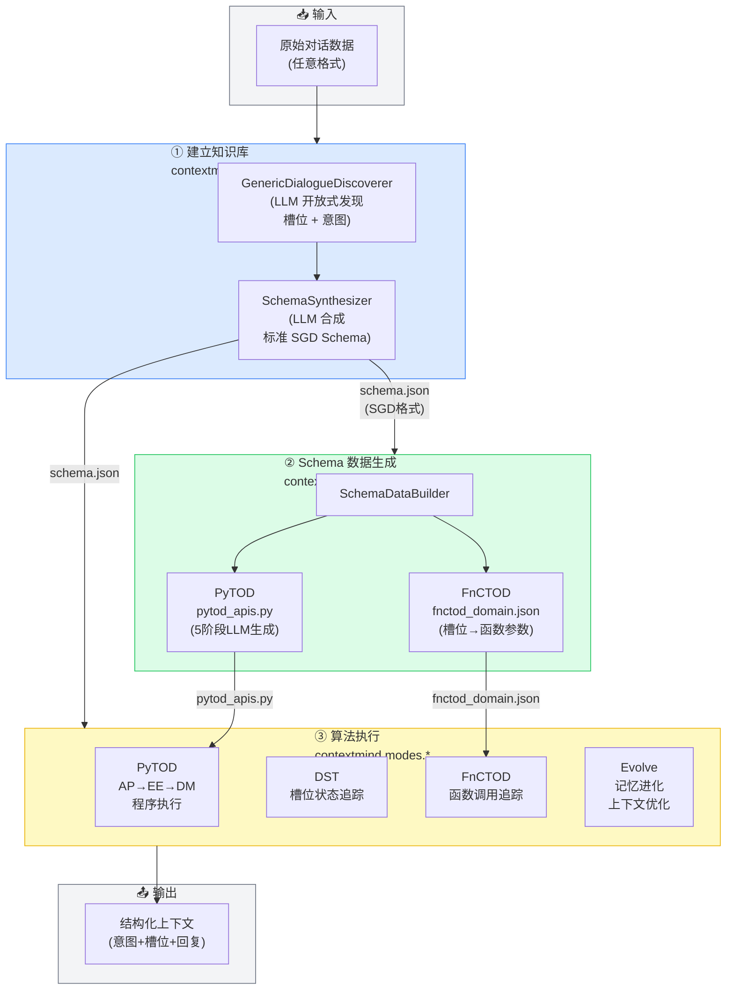

---

## 2. 模块依赖关系图

```mermaid
graph LR
    subgraph PKG["contextmind 包"]
        PIPE["pipeline.py\nContextPipeline"]

        subgraph INFRA["infra/"]
            LLM["llm_client.py\nAdkLLMClient"]
            EMB["embedding.py\nEmbeddingUtils"]
            LOG["logger.py"]
            DM["data_models.py"]
        end

        subgraph KB["knowledge/"]
            KBB["builder.py\nKnowledgeBaseBuilder"]
            DISC2["discoverer.py\nGenericDialogueDiscoverer"]
            SYNTH2["synthesizer.py\nSchemaSynthesizer"]
            NORM["normalizer.py"]
        end

        subgraph SB["schema_builder/"]
            SBLD["builder.py\nSchemaDataBuilder"]
            subgraph PYTOD_SB["pytod/"]
                SBGEN["generator.py\nPyTODApiCodeGenerator"]
                SBVAL["validator.py\nvalidate_function"]
                SBMOD["models.py\nTestCaseItem"]
                SBHLP["helpers.py\nSHARED_HELPERS"]
                SBPMT["prompts.py"]
                SBBLD["builder.py\nbuild_pytod_apis"]
            end
            subgraph FNCTOD_SB["fnctod/"]
                SBFN["builder.py\nbuild_fnctod_domain"]
            end
        end

        subgraph MODES["modes/"]
            BASE["base.py\nBaseTracker"]
            subgraph PYTOD_M["pytod/"]
                APT["tracker.py\nAdkPyTODTracker"]
                EE["execution_engine.py\nExecutionEngine"]
                PROM["prompts.py\nPyTODPromptBuilder"]
                SCH["schemas.py\nServiceSchema"]
            end
            subgraph DST_M["dst/"]
                DSTT["tracker.py\nDialogueStateTracker"]
                DSTP["prompts.py"]
                DSTP2["parser.py"]
            end
            subgraph FN_M["fnctod/"]
                FNT["tracker.py\nFnCTODTracker"]
                FM["function_manager.py\nFunctionManager"]
            end
            subgraph EV_M["evolve/"]
                ENG["core/engine.py\nEvolveEngine"]
                MEM["memory/"]
                PIP["pipeline/"]
                EVO["evolution/"]
            end
        end

        subgraph SCEN["scenarios/"]
            REG["registry.py\nScenarioRegistry"]
            BASE_S["base.py\nScenarioConfig"]
        end

        subgraph UI["ui/"]
            UICOMP["components.py"]
        end
    end

    PIPE --> KB
    PIPE --> MODES
    PIPE --> INFRA
    KBB --> DISC2
    KBB --> SYNTH2
    KBB --> NORM
    DISC2 --> LLM
    SYNTH2 --> LLM
    SBLD --> PYTOD_SB
    SBLD --> FNCTOD_SB
    SBGEN --> LLM
    APT --> EE
    APT --> PROM
    APT --> SCH
    APT --> LLM
    DSTT --> LLM
    FNT --> FM
    FNT --> LLM
    ENG --> MEM
    ENG --> PIP
    ENG --> LLM
    MODES --> BASE
    PIPE --> SCEN
```

---

## 3. 数据流端到端示意

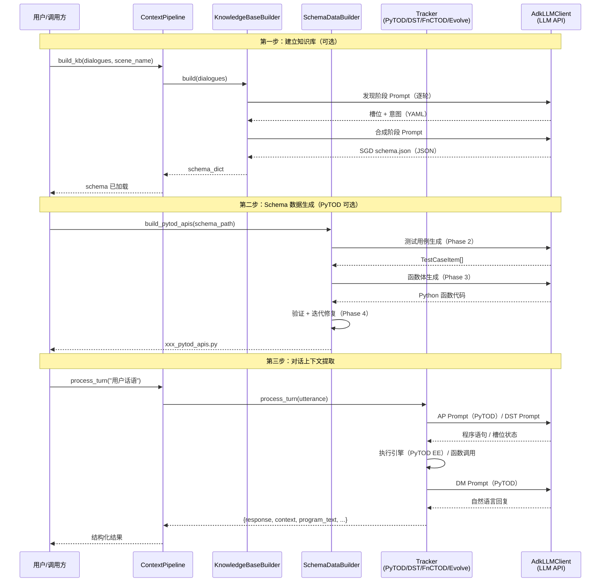

---

## 4. 第一步：知识库构建流水线

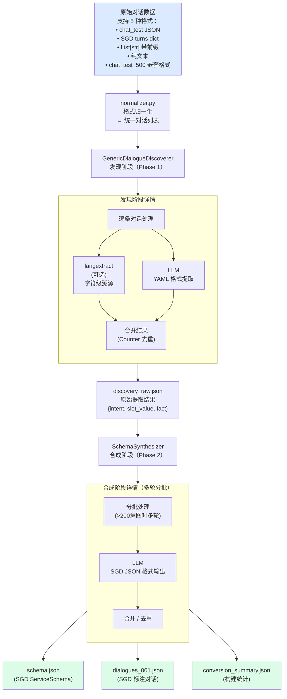

---

## 5. 第二步：Schema 数据生成（5 阶段流水线）

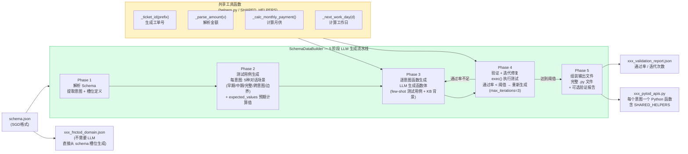

---

## 6. 第三步：四种算法执行模式

### 6.1 PyTOD — AP→EE→DM 三步程序执行

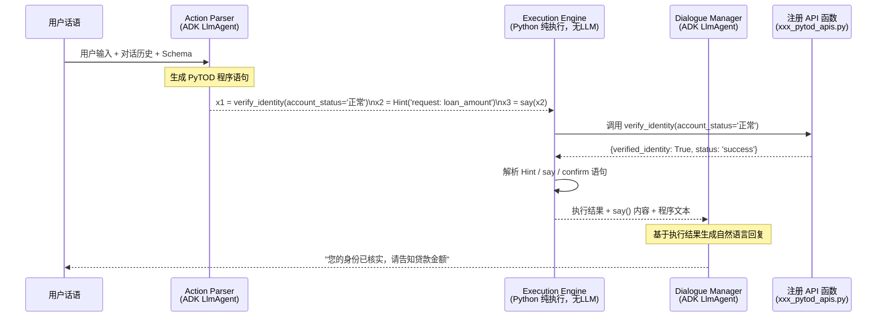

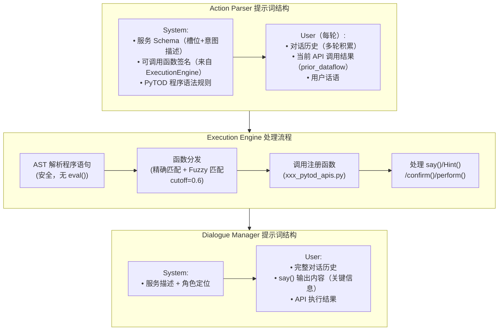

### 6.2 Evolve — 演化式上下文优化

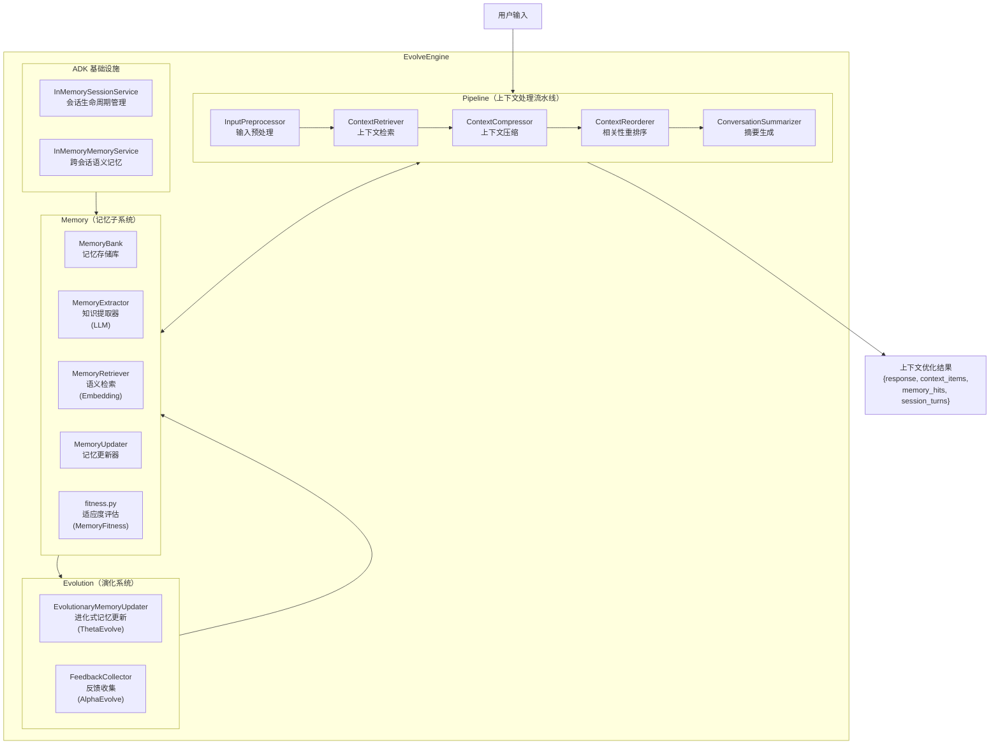

### 6.3 DST — 对话状态追踪

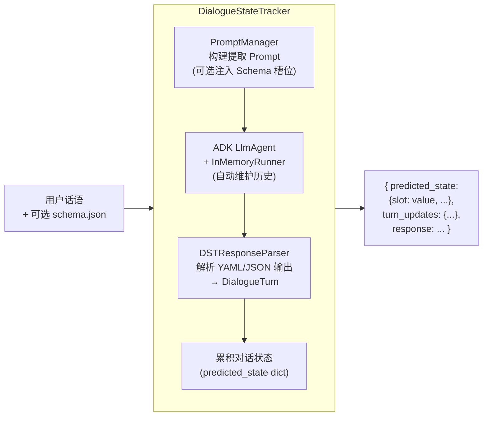

### 6.4 FnCTOD — 函数调用追踪

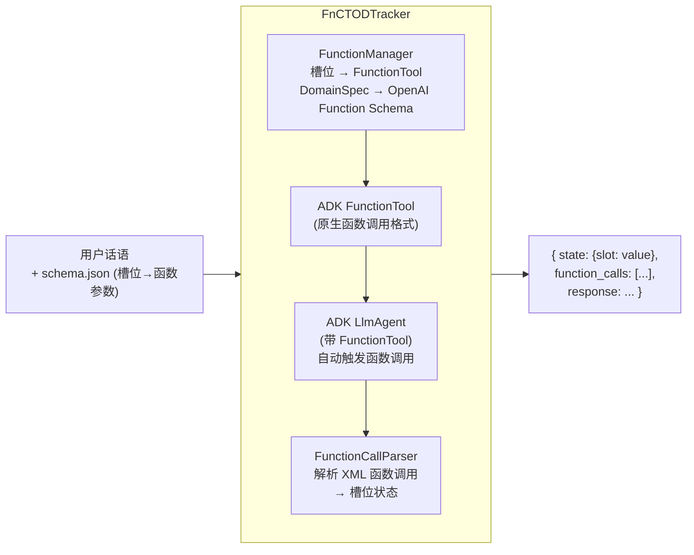

---

## 7. ContextPipeline 统一接口

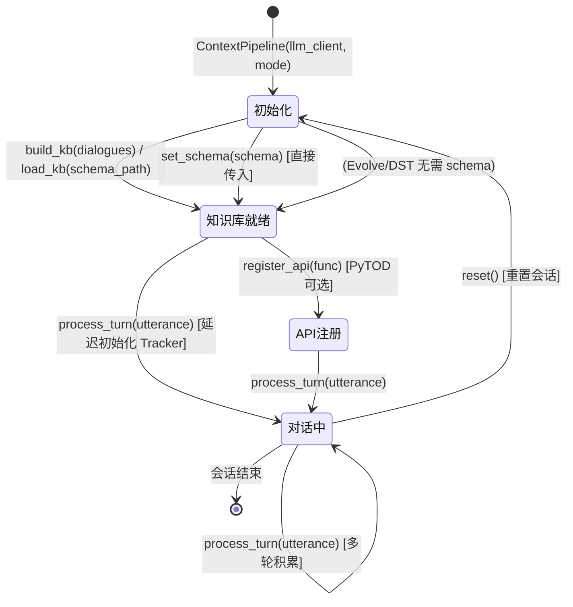

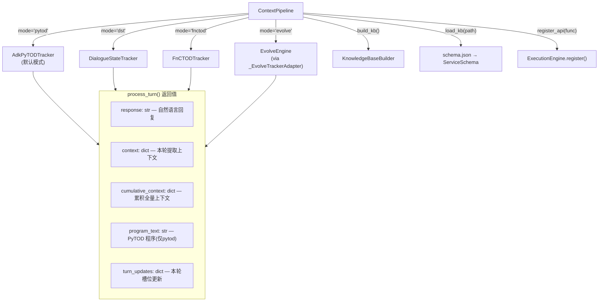

---

## 8. 基础设施层（infra）

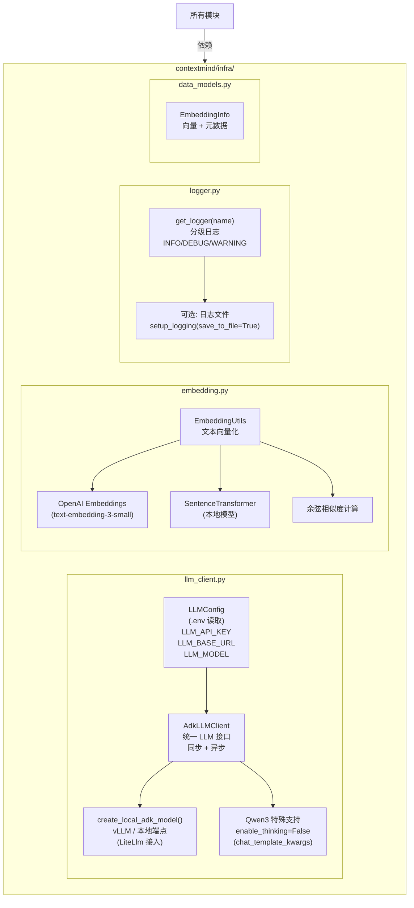

---

## 9. 算法步骤依赖矩阵

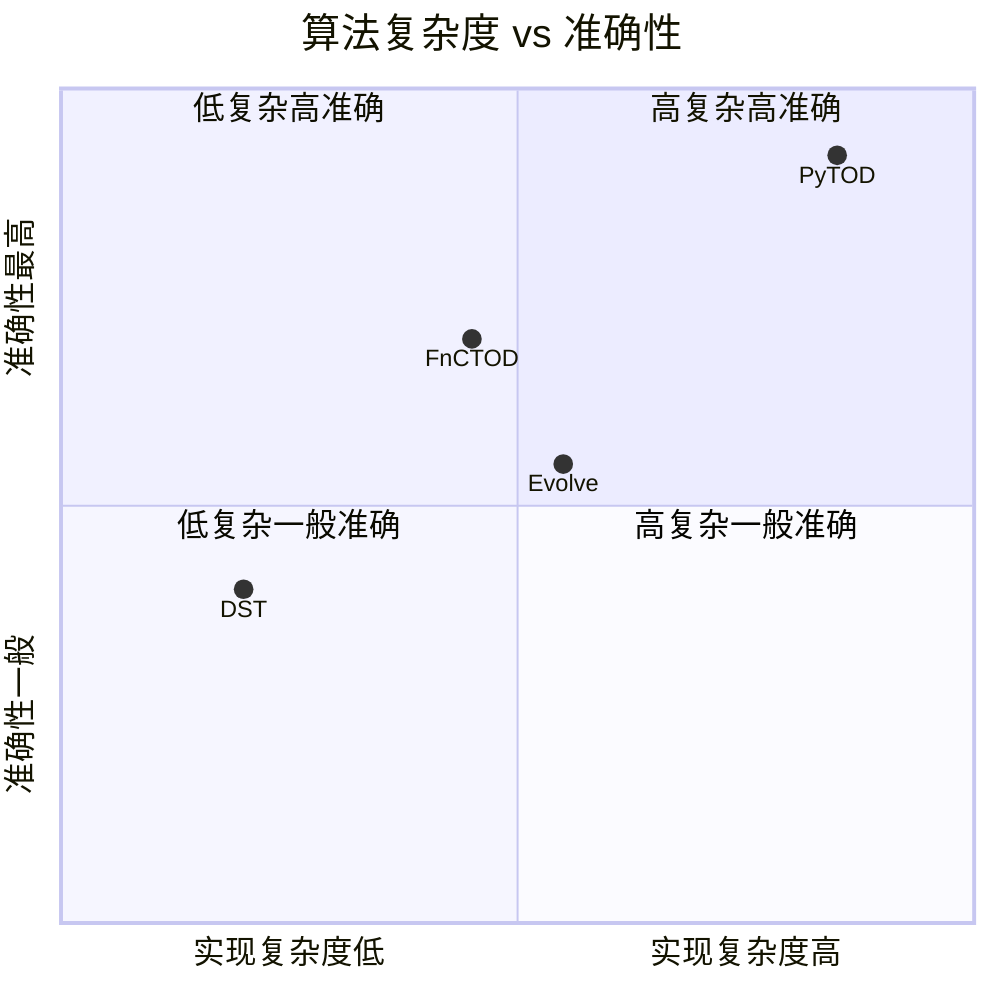

| 算法 | ① 建立知识库 | ② Schema 生成 | ③ 算法执行 | LLM 调用/轮 | 核心优势 |
|------|:-----------:|:------------:|:---------:|:----------:|---------|
| **DST** | ✅ 可选 | ❌ 不需要 | ✅ 必须 | 1次 | 最简单，通用槽位提取 |
| **FnCTOD** | ✅ 可选 | ❌ 不需要 | ✅ 必须 | 1次 | 原生函数调用，高精度 |
| **PyTOD** | ✅ 可选 | ✅ 可选 | ✅ 必须 | 2次(AP+DM) | 真实API调用+执行反馈 |
| **Evolve** | ❌ 不需要 | ❌ 不需要 | ✅ 必须 | 1次+ | 长期记忆，开放域对话 |

---

## 附：项目完整目录结构

```
ContextMind/
├── contextmind/                    # 主包
│   ├── __init__.py                 # 公开 API 导出
│   ├── pipeline.py                 # ContextPipeline（推荐统一入口）
│   │
│   ├── infra/                      # 基础设施层
│   │   ├── llm_client.py           # AdkLLMClient + LLMConfig
│   │   ├── embedding.py            # 文本向量化工具
│   │   ├── logger.py               # 统一日志
│   │   └── data_models.py          # 共享数据模型
│   │
│   ├── knowledge/                  # ① 知识库构建
│   │   ├── builder.py              # KnowledgeBaseBuilder（两阶段入口）
│   │   ├── discoverer.py           # GenericDialogueDiscoverer（发现）
│   │   ├── synthesizer.py          # SchemaSynthesizer（合成SGD Schema）
│   │   └── normalizer.py           # 多格式对话数据归一化
│   │
│   ├── schema_builder/             # ② Schema数据生成
│   │   ├── builder.py              # SchemaDataBuilder（顶层入口）
│   │   ├── pytod/                  # PyTOD companion生成（5阶段LLM）
│   │   │   ├── builder.py          # build_pytod_apis()
│   │   │   ├── generator.py        # PyTODApiCodeGenerator
│   │   │   ├── validator.py        # validate_function + _values_match
│   │   │   ├── models.py           # TestCaseItem + FuncValidation
│   │   │   ├── helpers.py          # SHARED_HELPERS工具函数库
│   │   │   └── prompts.py          # LLM提示词模板
│   │   └── fnctod/                 # FnCTOD companion生成（直接转换）
│   │       └── builder.py          # build_fnctod_domain()
│   │
│   ├── modes/                      # ③ 算法执行层
│   │   ├── base.py                 # BaseTracker协议
│   │   ├── pytod/                  # PyTOD：AP→EE→DM程序执行
│   │   │   ├── tracker.py          # AdkPyTODTracker
│   │   │   ├── execution_engine.py # ExecutionEngine（安全执行）
│   │   │   ├── prompts.py          # PyTODPromptBuilder
│   │   │   ├── schemas.py          # ServiceSchema + load_schema_from_dict
│   │   │   └── registry.py         # API函数注册表
│   │   ├── dst/                    # DST：对话状态追踪
│   │   │   ├── tracker.py          # DialogueStateTracker
│   │   │   ├── prompts.py          # 槽位提取Prompt
│   │   │   └── parser.py           # YAML/JSON响应解析
│   │   ├── fnctod/                 # FnCTOD：函数调用追踪
│   │   │   ├── tracker.py          # FnCTODTracker
│   │   │   ├── function_manager.py # FunctionManager + DomainSpec
│   │   │   └── schemas.py          # FnCTOD专用Schema
│   │   └── evolve/                 # Evolve：演化式上下文优化
│   │       ├── core/               # EvolveEngine + 数据模型 + 配置
│   │       ├── memory/             # MemoryBank + 提取/检索/更新/适应度
│   │       ├── pipeline/           # 上下文处理流水线（5步）
│   │       └── evolution/          # 演化算法（ThetaEvolve + AlphaEvolve）
│   │
│   ├── scenarios/                  # 场景注册与配置
│   │   ├── registry.py             # ScenarioRegistry（YAML驱动）
│   │   ├── base.py                 # ScenarioConfig基类
│   │   └── anyihua/ callcenter/ chat/ insurance/  # 内置场景
│   │
│   └── ui/                         # Gradio UI组件
│       ├── components.py           # create_layout / bind_events
│       └── styles.py               # CUSTOM_CSS
│
├── examples/                       # 示例脚本
│   ├── context_pipeline_demo.py    # ContextPipeline 端到端演示
│   ├── build_kb_demo.py            # 第一步：知识库构建
│   └── build_schema_data.py        # 第二步：Schema数据生成
│
├── benchmark/                      # 评测框架
├── resources/                      # 静态资源与测试数据
└── docs/                           # 文档（本目录）
```

---

**最后更新**: 2026-04-01 | **版本**: 0.3.0
