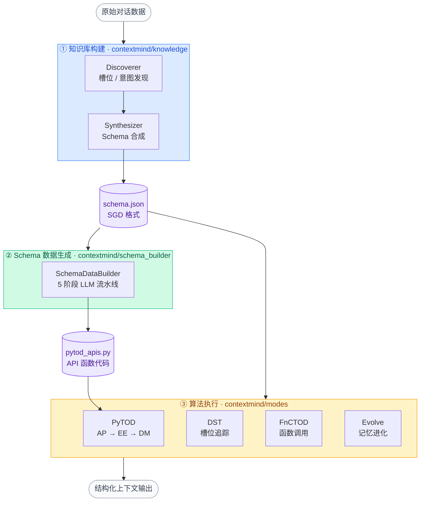
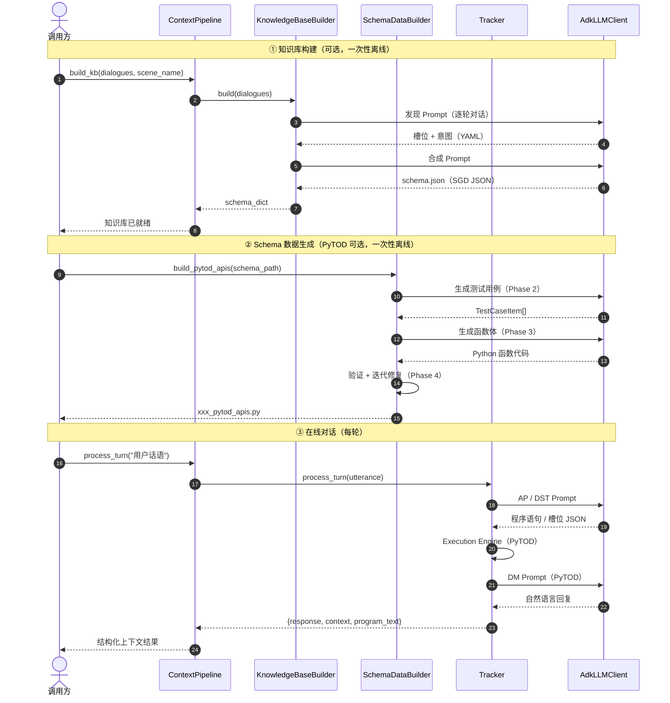
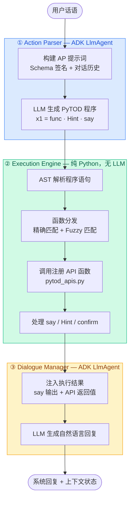
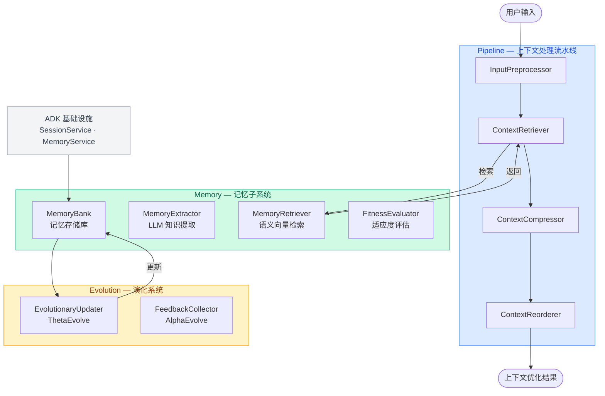

# ContextMind 架构图

> **版本**：0.3.0 | **最后更新**：2026-04-01

本文档从四个视角描述 ContextMind 框架架构：整体框架、端到端数据流、PyTOD 算法细节、Evolve 记忆系统。

---

## 目录

1. [整体框架](#1-整体框架)
2. [模块说明](#2-模块说明)
3. [端到端调用流程](#3-端到端调用流程)
4. [PyTOD 执行流程](#4-pytod-执行流程)
5. [Evolve 记忆架构](#5-evolve-记忆架构)
6. [算法对比](#6-算法对比)
7. [项目目录结构](#7-项目目录结构)

---

## 1. 整体框架

ContextMind 的核心设计是**三步框架**，由 `ContextPipeline` 作为统一入口串联，不同算法对各步骤的依赖程度不同。



---

## 2. 模块说明

下表列出 `contextmind/` 下各子包的核心类与职责：

| 子包 | 核心类 | 职责 |
|------|--------|------|
| `pipeline.py` | `ContextPipeline` | 统一三步框架入口，管理 Tracker 生命周期 |
| `infra/llm_client.py` | `AdkLLMClient` | LLM 统一接入（OpenAI / Qwen / 本地 vLLM） |
| `infra/embedding.py` | `EmbeddingClient` | 文本向量化，支持 OpenAI / SentenceTransformer |
| `knowledge/builder.py` | `KnowledgeBaseBuilder` | 两阶段（发现 + 合成）知识库构建入口 |
| `knowledge/discoverer.py` | `GenericDialogueDiscoverer` | LLM + langextract 开放式槽位 / 意图发现 |
| `knowledge/synthesizer.py` | `SchemaSynthesizer` | 将发现结果合成为 SGD ServiceSchema |
| `knowledge/normalizer.py` | `normalize_dialogues` | 5 种输入格式归一化为统一对话列表 |
| `schema_builder/builder.py` | `SchemaDataBuilder` | Schema → 算法专用数据（PyTOD / FnCTOD） |
| `schema_builder/pytod/` | `PyTODApiCodeGenerator` | 5 阶段 LLM 生成 + 验证 + 修复 API 函数代码 |
| `modes/base.py` | `BaseTracker` | 所有追踪器的共享协议（结构子类型） |
| `modes/pytod/tracker.py` | `AdkPyTODTracker` | PyTOD 三步（AP / EE / DM）流程编排 |
| `modes/pytod/execution_engine.py` | `ExecutionEngine` | 安全执行 PyTOD 程序语句（无 eval，含模糊匹配） |
| `modes/pytod/schemas.py` | `ServiceSchema` | SGD Schema 数据模型与加载工具 |
| `modes/dst/tracker.py` | `DialogueStateTracker` | 基于 ADK LlmAgent 的槽位状态追踪 |
| `modes/fnctod/tracker.py` | `FnCTODTracker` | ADK 原生函数调用式对话状态追踪 |
| `modes/fnctod/function_manager.py` | `FunctionManager` | Schema 槽位 → ADK FunctionTool 转换 |
| `modes/evolve/core/engine.py` | `EvolveEngine` | 演化式上下文优化引擎（AlphaEvolve + ThetaEvolve） |
| `scenarios/registry.py` | `ScenarioRegistry` | YAML 驱动的场景配置注册与查询 |
| `ui/components.py` | — | Gradio UI 布局与事件绑定 |

---

## 3. 端到端调用流程

展示从 `ContextPipeline` 到各模块的完整调用链：



---

## 4. PyTOD 执行流程

PyTOD 将任务型对话建模为**程序执行**问题，每轮对话经历三个串行步骤：



**关键设计点：**

- **ExecutionEngine** 不使用 `eval()`，通过 AST 解析安全执行程序语句
- **Fuzzy 匹配**（`difflib`，阈值 0.6）可纠正 AP 幻觉出的近似函数名
- **stub 过滤**：schema 自动注册的 stub 函数结果（`{"status":"success","intent":"..."}` ）不注入 DM，避免歧义
- **say() 机制**：AP 通过 `say(x1.field)` 向 DM 传递需要口播的关键字段，DM 不直接读取 API 原始结果

---

## 5. Evolve 记忆架构

Evolve 基于 **AlphaEvolve + ThetaEvolve** 双算法，通过会话记忆和长期记忆实现上下文持续优化：



---

## 6. 算法对比

### 步骤依赖

| 算法 | ① 知识库 | ② Schema 生成 | ③ 算法执行 |
|------|:--------:|:------------:|:---------:|
| **DST** | 可选 | 不需要 | ✅ 必须 |
| **FnCTOD** | 可选 | 不需要 | ✅ 必须 |
| **PyTOD** | 可选 | 可选 | ✅ 必须 |
| **Evolve** | 不需要 | 不需要 | ✅ 必须 |

### 技术特性

| 维度 | DST | FnCTOD | PyTOD | Evolve |
|------|-----|--------|-------|--------|
| **输出类型** | 槽位状态 JSON | 函数调用 XML | 可执行程序 | 上下文列表 |
| **真实 API 调用** | ❌ | ❌ | ✅ | ❌ |
| **执行反馈** | ❌ | ❌ | ✅ | ❌ |
| **长期记忆** | ❌ | ❌ | ❌ | ✅ |
| **每轮 LLM 调用** | 1 次 | 1 次 | 2 次（AP + DM） | 1 次+ |
| **实现复杂度** | ⭐⭐ | ⭐⭐⭐ | ⭐⭐⭐⭐⭐ | ⭐⭐⭐⭐ |
| **适用场景** | 通用槽位提取 | 标准函数调用 | 任务型精确对话 | 开放域长对话 |

---

## 7. 项目目录结构

```text
contextmind/                    # 主包
├── pipeline.py                 # ContextPipeline（推荐统一入口）
│
├── infra/                      # 基础设施层（所有模块共用）
│   ├── llm_client.py           # AdkLLMClient + LLMConfig
│   ├── embedding.py            # EmbeddingUtils（向量化 + 相似度）
│   ├── logger.py               # 统一日志
│   └── data_models.py          # 共享数据模型
│
├── knowledge/                  # ① 知识库构建
│   ├── builder.py              # KnowledgeBaseBuilder（两阶段入口）
│   ├── discoverer.py           # GenericDialogueDiscoverer
│   ├── synthesizer.py          # SchemaSynthesizer
│   └── normalizer.py           # 多格式对话归一化
│
├── schema_builder/             # ② Schema 数据生成
│   ├── builder.py              # SchemaDataBuilder（顶层入口）
│   ├── pytod/                  # PyTOD companion 生成（5 阶段 LLM）
│   │   ├── builder.py          # build_pytod_apis()
│   │   ├── generator.py        # PyTODApiCodeGenerator
│   │   ├── validator.py        # validate_function + _values_match
│   │   ├── models.py           # TestCaseItem + FuncValidation
│   │   ├── helpers.py          # SHARED_HELPERS 工具函数
│   │   └── prompts.py          # LLM 提示词模板
│   └── fnctod/                 # FnCTOD companion 生成（直接转换）
│       └── builder.py
│
├── modes/                      # ③ 算法执行层
│   ├── base.py                 # BaseTracker 协议
│   ├── pytod/                  # PyTOD：AP → EE → DM
│   │   ├── tracker.py          # AdkPyTODTracker
│   │   ├── execution_engine.py # ExecutionEngine（安全执行）
│   │   ├── prompts.py          # PyTODPromptBuilder
│   │   ├── schemas.py          # ServiceSchema
│   │   └── registry.py         # API 函数注册表
│   ├── dst/                    # DST：对话状态追踪
│   │   ├── tracker.py
│   │   ├── prompts.py
│   │   └── parser.py
│   ├── fnctod/                 # FnCTOD：函数调用追踪
│   │   ├── tracker.py
│   │   ├── function_manager.py
│   │   └── schemas.py
│   └── evolve/                 # Evolve：演化式上下文优化
│       ├── core/               # EvolveEngine + 数据模型 + 配置
│       ├── memory/             # MemoryBank / Extractor / Retriever / fitness
│       ├── pipeline/           # 5 步上下文处理流水线
│       └── evolution/          # EvolutionaryUpdater + FeedbackCollector
│
├── scenarios/                  # 场景注册与配置
│   ├── registry.py             # ScenarioRegistry（YAML 驱动）
│   └── anyihua/ callcenter/ chat/ insurance/
│
└── ui/                         # Gradio UI 组件
    ├── components.py
    └── styles.py
```

---

**最后更新**：2026-04-01 | **版本**：0.3.0
